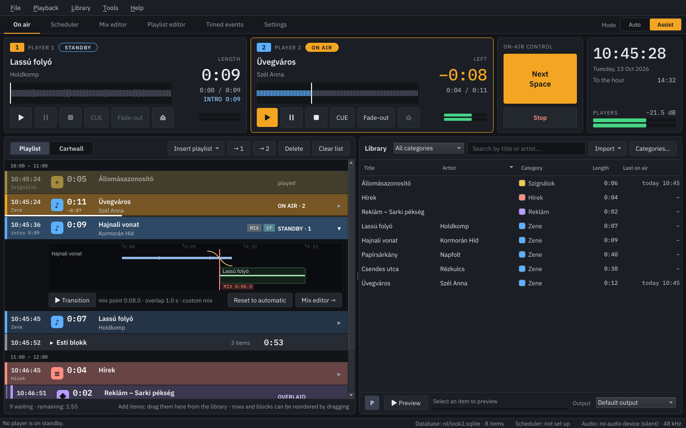
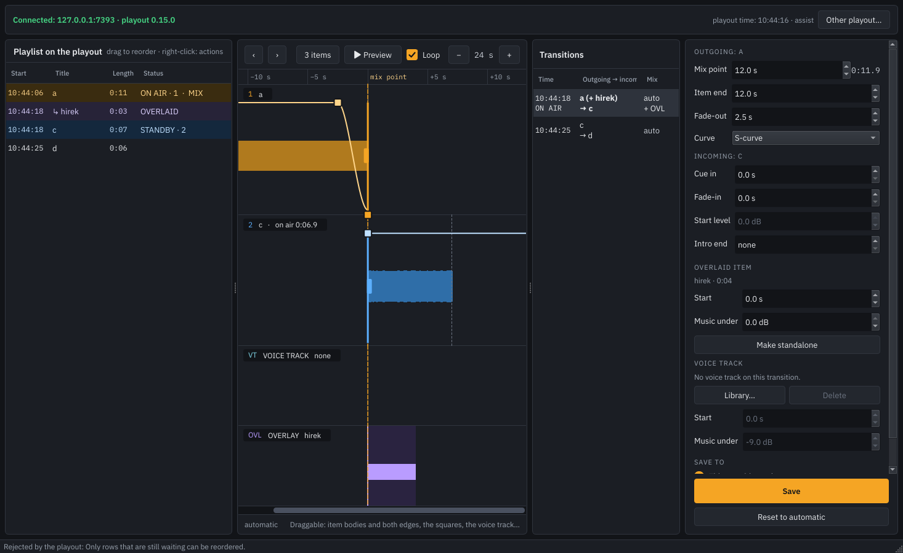
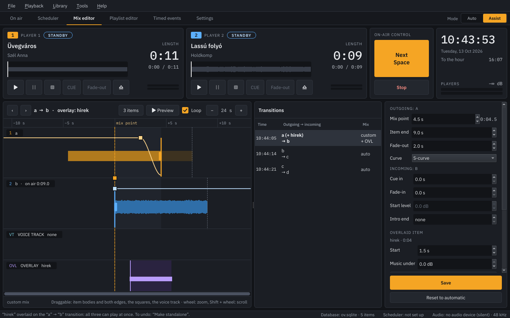
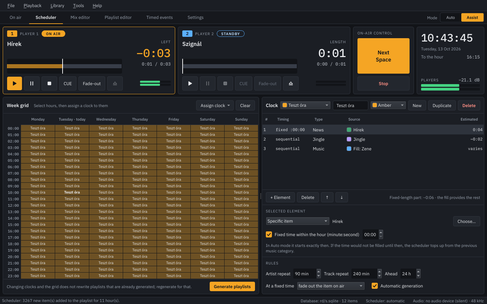
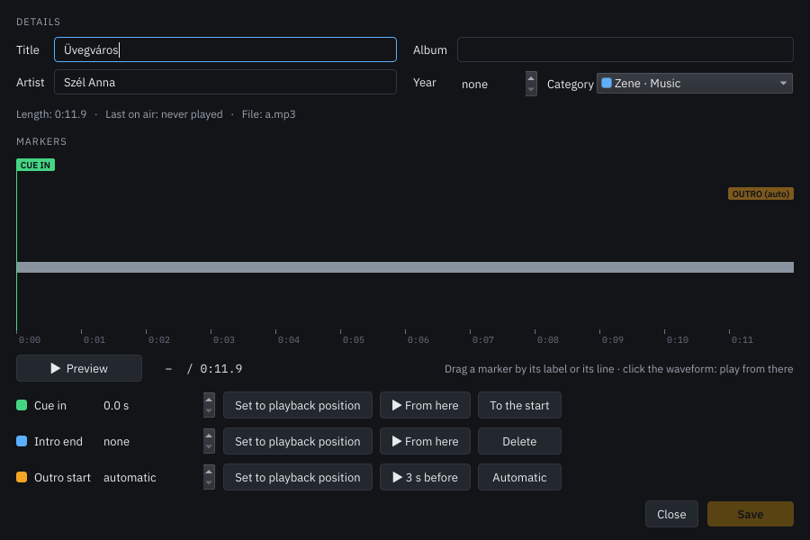

# Éter

Rádiós adáslebonyolító Linuxra és Windowsra: két lejátszó, cartwall, hangtár, ütemező, mix editor és
távoli playlist-szerkesztés egyetlen asztali alkalmazásban.

*English: [README.md](README.md)*

## Funkciók

### Adás

- **Két lejátszó** hullámformával, intro-visszaszámlálóval, automata vagy asszisztált átúsztatással.
  Minden csatorna (1-es és 2-es lejátszó, előhallgatás, cartwall) külön hangkártyára tehető.
- **Playlist** tervezett adásidővel és óraelválasztókkal. Minden sor mutatja a kezdést, a típusikont,
  a hosszt, a címet és az előadót, valamint az egyedi mix (MIX), a voice track (VT) és a fix időpont (FIX)
  jelzését. A nem zenei elemeket a kategóriájuk színe tölti ki; az adásban és a készenlétben lévő elem
  kiemelve látszik, az adásban lévőn haladási sávval.
- **A playlist követi az adásban lévő elemet**, amíg el nem görgetsz róla; visszagörgetve újra követi.
- **Mini mix editor a playlistben**: a sor végén lévő nyíl lenyitja az átmenetet a következő elemmel.
  A következő elem a kimenő végére húzható, az átmenet meghallgatható, visszaállítható, vagy megnyitható a
  teljes Mix editorban.
- **Ráfektetés**: egy elem az előtte és utána álló elem átmenetére fektethető, így mindhárom egyszerre szól
  (például egy szignál egy átúsztatás fölött). A saját csatornáján szól; várakozó elemen jobb gomb →
  „Ráfektetés az átmenetre”, vagy húzással a Mix editorban (lásd lent).
- **Cartwall** a playlist helyén: színes gombfalak azonnal induló hangokkal, a hangtárból vagy fájlból
  feltöltve, saját kimenettel (alapból az 1-es lejátszóét követi).
- **Adásnapló** CSV-exporttal.

### Előkészítés

- **Hangtár** SQLite adatbázisban, saját kategóriákkal, fájlok és egész mappák importálásával,
  elemszerkesztővel (cím, előadó, album, év, kategória, kezdőpont, intro és outro jelölő).
- **Ütemező**: órasémák kategóriákból, fix idejű elemekkel és kitöltéssel, heti rács,
  előadó- és számismétlési szabályok, automatikus előre generálás.
- **Mix editor**: két vagy három egymást követő elem átmenete idővonalon állítható: mix pont, a kimenő elem
  vége, úsztatási görbék, kezdőpont, beúsztatás, intro, voice track (felvétel vagy fájl) és zenehalkítás,
  előhallgatással. Hármas nézetben a harmadik elemet a második eleje elé húzva és elengedve a középső elem
  ráfekszik az átmenetre, saját sávval.
- **Playlist szerkesztő**: kézzel összeállított playlistek mentése kategóriába, és beillesztésük
  a fő playlistbe kinyitható blokként.
- **Időzítések**: egy hangtárelem vagy mentett playlist beküldése a playlistbe (következőként vagy a
  végére), vagy azonnali indítása adásba; egyszer egy adott napon, vagy hetente a kiválasztott napokon.

### Távoli szerkesztés

Egy playout gép már legenerált playlistje egy másik gépről szerkeszthető a hálózaton át: sorrend, törlés,
ráfektetés és a teljes Mix editor előhallgatással. Minden módosítást a playout hajt végre azonnal, a saját
adatbázisában és az adásban; minden csatlakozott szerkesztő az élő állapotot látja.

1. **A playout gépen**: Eszközök → Beállítások → Távoli szerkesztés. Pipáld be az *Engedélyezve*
   lehetőséget, adj meg portot (alapból 7341) és jelszót (legalább 6 karakter), majd *Alkalmazás*. Alatta
   látszanak a gép IP-címei. A tűzfalon engedélyezd a portot.
2. **A szerkesztő gépen**: Fájl → Távoli szerkesztő (vagy az Éter indítása `--editor` kapcsolóval; Windowson
   az `Eter-szerkeszto.cmd`). Add meg a playout IP-címét, a portot és a jelszót. A hangfájlokat a szerkesztő
   közös hálózati mappából olvassa: add meg a mappát úgy, ahogy a playout látja (például `D:\Zene`), és úgy,
   ahogy ez a gép (például `\\radio\Zene`, Linuxon `smb://radio/Zene`, ha a megosztást a fájlkezelőben már
   megnyitottad, vagy egy felcsatolt mappa, például `/mnt/zene`), vagy hagyd mindkettőt üresen, ha az útvonal azonos.

A szerkesztő nem játszik adást, és a saját adatbázisához sem nyúl. A jelszó nem utazik a hálózaton
(kérdés–válasz HMAC-SHA256-tal), a playout pedig csak egy belőle képzett kulcsot tárol. Ha a kapcsolat
megszakad vagy a playout újraindul, a szerkesztő magától visszacsatlakozik. Voice track a szerkesztőben a
hangtárból választható; felvétel és fájlból betöltés csak a playouton érhető el.

### Egyéb

- Angol és magyar felület (Beállítások → Nyelv).
- Egy adatbázissal egyszerre csak egy példány futhat: a második ugyanazt a playlistet játszaná egyszerre.

| Mix editor ráfektetett elemmel | Ütemező |
|---|---|
|  |  |

## Telepítés

### Linux

Töltsd le a legfrissebb `Eter-…-x86_64.AppImage` fájlt a Releases oldalról, majd:

    chmod +x Eter-*-x86_64.AppImage
    ./Eter-*-x86_64.AppImage

64 bites Linux kell hozzá glibc 2.39-cel vagy újabbal (Ubuntu 24.04 és későbbi, illetve hasonló
disztribúciók), a hanghoz PipeWire, PulseAudio, ALSA vagy JACK. A hangtár helye
`~/.local/share/eter/library.sqlite`, a beállításoké `~/.config/Eter/Eter.conf`.

### Windows

Töltsd le az `Eter-…-win64.zip` fájlt a Releases oldalról, csomagold ki bárhová, és indítsd el az
`eter.exe`-t (64 bites Windows 10 vagy 11); az `Eter-szerkeszto.cmd` a távoli szerkesztőt indítja. A program
nincs digitálisan aláírva, ezért az első indításkor a Windows „ismeretlen kiadó” figyelmeztetést adhat. A hang
WASAPI-n megy. A hangtár helye `%LOCALAPPDATA%\eter\library.sqlite`, a beállítások a rendszerleíró
adatbázisban vannak (`HKEY_CURRENT_USER\Software\Eter`).

A windowsos változat jóval kevesebb tesztelést kapott, mint a linuxos.

### Mindkettő

A hangfájlokat a program nem másolja és nem módosítja, a hangtár csak hivatkozik rájuk. A korábbi verziók
adatbázisát az első indításkor automatikusan frissíti.

Hasznos kapcsolók: `--editor` (távoli szerkesztő), `--backend NÉV` (Linuxon `pulseaudio`, `alsa`, `jack`;
Windowson `wasapi`, `dsound`), `--db FÁJL` (másik adatbázis), `--selftest FÁJL` (a hangmotor ellenőrzése egy
hangfájllal), `--help`.

## Fordítás forrásból

### Linux

Ubuntu 24.04-en vagy újabbon:

    sudo apt install build-essential cmake ninja-build nasm git curl \
        qt6-base-dev libqt6sql6-sqlite qt6-wayland libgl1-mesa-dev
    scripts/build_ffmpeg.sh      # kis, statikus FFmpeg csak hangdekóderekkel, a third_party/ffmpeg alá
    cmake -S . -B build/release -G Ninja
    cmake --build build/release
    build/release/eter

AppImage készítése (első alkalommal letölti a linuxdeploy eszközt):

    scripts/build_appimage.sh    # eredmény: build/Eter-<verzió>-x86_64.AppImage

### Windows

[MSYS2](https://www.msys2.org/) **UCRT64** parancssorban:

    pacman -S --needed git make diffutils zip mingw-w64-ucrt-x86_64-gcc mingw-w64-ucrt-x86_64-cmake \
        mingw-w64-ucrt-x86_64-ninja mingw-w64-ucrt-x86_64-nasm mingw-w64-ucrt-x86_64-qt6-base
    scripts/build_ffmpeg.sh
    scripts/build_windows.sh     # eredmény: build/Eter-<verzió>-win64.zip

VS Code-ból: telepítsd az MSYS2-t az alapértelmezett helyére (`C:\msys64`), nyisd meg a projekt
mappáját, majd Terminal → Run Task…, és futtasd sorban az „Éter: 1 … 4” nevű feladatokat (az első
kettőt csak egyszer kell). Utána a Ctrl+Shift+B újraépíti a csomagot. A projekt olyan útvonalon
legyen, amelyben nincs szóköz és ékezetes betű, például `C:\eter`.

### Kiadások

Ha egy `v0.15.0` formájú címkét (tag) töltesz fel, a `.github/workflows/build.yml` munkafolyamat
megépíti az AppImage-et és a windowsos zipet, és egy kiadáshoz (release) csatolja őket.

## A forrás felépítése

- `src/audio` – dekóder (FFmpeg → 48 kHz sztereó), források (dekódoló szál és gyűrűpuffer),
  hangmotor (miniaudio: kimenetek, útválasztás, keverés, felvétel)
- `src/ui` – főablak, lejátszók, hangtár, ütemező, mix editor és mini mix editor, playlist szerkesztő,
  cartwall, időzítések, távoli szerkesztő
- `src/net` – a távoli szerkesztés protokollja (soronkénti JSON TCP-n, HMAC-belépés), szerver és kliens
- `src/db` – SQLite réteg és adatbázis-frissítések; `schema.sql` – az adatbázis sémája
- `src/sched` – playlist-generálás
- `packaging` – asztali bejegyzés, windowsos erőforrások, az AppImage-ben használt libproxy-helyettesítő
- `i18n/en.json` – a felület angol szövegei

A forrás megjegyzései magyarul vannak. Az egyes verziók változásai: [CHANGELOG.md](CHANGELOG.md).

## Fordítások

A felület szövegei a forrásban magyarul vannak, `TR("magyar szöveg")` alakban; az angol
megfelelőjük az `i18n/en.json` fájlban van. Módosítás után `python3 scripts/gen_i18n.py`
generálja újra a táblát.

## Készítők

Tervezte és irányította: laczfy001. A kódot Claude, az Anthropic MI-asszisztense írta.

## Licenc

Az Éter szabad szoftver, a [GNU General Public License 3.0 vagy újabb](LICENSE) feltételei
szerint. A felhasznált könyvtárak és licenceik: [THIRD-PARTY-NOTICES.md](THIRD-PARTY-NOTICES.md).
