# Éter

Rádiós adáslebonyolító Linuxra és Windowsra: három lejátszó (A, B, C) automatikus vagy kézzel beállított keveréssel,
cartwall, hangtár, ütemező, mix editor, távoli playlist-szerkesztés, adásrögzítés, „most szól” kiírás Icecasthoz és
tartalék playout egyetlen asztali alkalmazásban.

**Weboldal és letöltés: [laczfy001.github.io/eter](https://laczfy001.github.io/eter/)** (angolul) · *English: [README.md](README.md)*

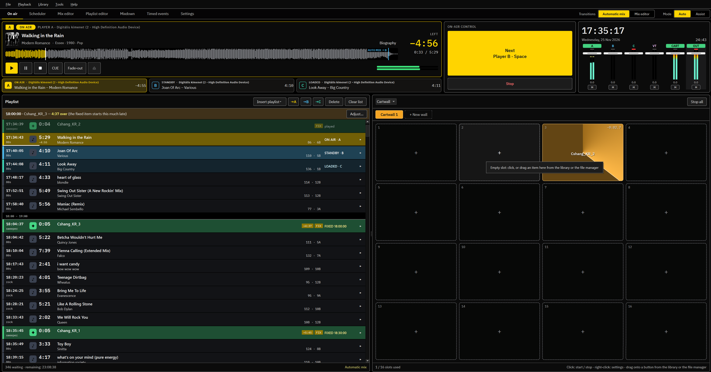

## Funkciók

### Adás

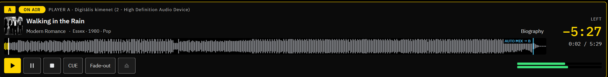

- **Három lejátszó (A, B, C)**, ebből a főablakban egy látszik: az, amelyik adásban van. Alatta egy sáv mutatja
  mindhármat (ADÁSBAN / KIÚSZIK / KÉSZENLÉT, cím, idő, kimenet), és amíg szól, a voice trackot is; a sávon egy
  lejátszóra kattintva az látszik. Három lejátszóval egy zene, egy jingle és a következő zene egyszerre is szólhat
  (a következő dal már a jingle alatt indul, miközben az előző még kiúszik), automata és asszisztált módban is.
  Hullámforma, intro-visszaszámláló, mix pont a hullámformán, automata vagy asszisztált átúsztatás. Az adásban
  lévő elem utolsó 10 másodpercében piros visszaszámláló jelenik meg az ablak alján (automata módban a mix pontig
  számol); nem kattintható.
  Minden csatorna (A, B és C lejátszó, előhallgatás, cartwall) külön hangkártyára tehető.
- **Mixdown**: elemek sorozata voice trackekkel, saját idővonalon (az átmenetek az okos mix szerint állnak be, utána
  szabadon állíthatók; a voice track oda kerül, ahová az idővonalon kattintottál), és kikeverés egyetlen MP3 vagy WAV fájlba, amely a hangtár „Mixdown” kategóriájába is bekerül.
- **Mini mixer** az óra paneljén: jelszint és fader a három lejátszóhoz, a voice trackhez, a cartwallhoz és a fő
  kimenethez, némítással.
- **Ének-szabály**: a számok énekét (férfi, női, együttes, vegyes, instrumentális) egyenként vagy a hangtárban sokat
  egyszerre megadva korlátozható, hány azonos ének jöhet egymás után.
- **Okos automatikus mix**: felismeri a lecsengő és a hirtelen véget, a lágy és az erős kezdést, és (ha kéred) ütköző
  tempónál vagy hangnemnél rövidebb az átfedés; minden küszöb állítható a *Beállítások → Automatikus mix* lapon
  (élő ábrával arról, hogyan keveredik két mintaelem), és a Mix editor minden átmenetnél megmutatja a tervet. A
  jingle, reklám, hírek és voice track szorosan, a csend levágásával követik egymást; a hosszú csend utáni rejtett szám kimarad; a csendvédelem továbblép, ha a szóló elem sokáig néma.
- **Élő stream**: Icecast/Shoutcast stream (MP3, AAC, Ogg; http vagy https; a .pls/.m3u listát is feloldja) a playlist
  elemeként, tervezett hosszal; megszakadáskor újrakapcsolódik, és ha nem jön vissza, továbblép.
- **Automatikus mix / Mix editor** kapcsoló a felső sávban: *Automatikus mix* állásban a két zene közti átmeneteket
  a program keveri a hullámforma alapján (a következő dal eleji csendje kimarad); ahol bármelyik oldal nem zene
  (jingle, hírek, reklám), ott a Mix editorban mentett beállítás érvényes, és a mentett voice track is megszólal.
  *Mix editor* állásban minden átmenet a mentett beállítás szerint szól.
- **Hangerőgörbe** elemenként, a hullámformán rajzolva a Mix editorban vagy az elemszerkesztőben: például a hírek
  szignál eleje teljes hangerőn szól, az alapja halkabban folytatódik a hírolvasó alatt. Bárhol szól az elem, így szól.
- **Most szól**: az adásban lévő elem címét minden váltáskor szövegfájlba írja, sablon szerint (`%artist% - %title%`,
  továbbá `%category%`, `%duration%`, `%next_artist%`, `%next_title%`, `%time%`). Ebből olvashatja a stream kódoló
  (butt, Liquidsoap, Mixxx, OBS…), egy weboldal vagy egy képernyőfelirat. Jingle és más nem zenei elem alatt
  maradhat az előző zene címe, de kiírható a saját címe vagy egy állandó szöveg is. Ha kell, az Éter közvetlenül az
  Icecast szerver metaadatát is frissíti (admin/metadata). Beállítások → Most szól.
- **Weboldal (WordPress)**: az Éter Radio bővítménnyel (`eter-radio.zip`, minden kiadás mellett) az oldalon
  *Most szól*, *Következő számok* és *Számkérés* blokk használható (és a `[eter_now_playing]`, `[eter_up_next]`,
  `[eter_request]` rövidkód). Az Éter néhány másodpercenként elküldi, mi szól, és begyűjti a kéréseket; a kapcsolatot
  mindig ő kezdeményezi (aláírt HTTPS), így a stúdió gépét nem kell az internet felől elérhetővé tenni. A kért szám
  a most szóló elem után kerül a playlistbe, a korábbi kérések alá, KÉRÉS jelöléssel; ha nincs kérés, a playlist a
  szokásos módon megy. A kérés magától bekerülhet, vagy jóváhagyásra várhat (Kérések gomb a felső sávban), és
  korlátozható kijelölt kategóriákra és kijelölt sémák óráira. Beállítások → Weboldal; a WordPressben:
  Beállítások → Éter Radio (itt állítható a bővítmény nyelve is: alapból angol, választható holland, magyar, vagy
  az oldal nyelve). A *Legtöbbet játszott* blokk az elmúlt nap, hét vagy hónap legtöbbet játszott dalait mutatja.
- **Éter Web** (`eter-web.zip`): ugyanezek a blokkok bármilyen, WordPress nélküli weboldalra – egy mappa bármely PHP-s
  tárhelyen, beágyazás egy script sorral (vagy iframe-mel). Lásd: `web/eter-web/README.txt`.
- **Playlist** tervezett adásidővel és óraelválasztókkal. Minden sor mutatja a kezdést, a típusikont,
  a hosszt, a címet és az előadót, valamint az egyedi mix (MIX), a voice track (VT) és a fix időpont (FIX)
  jelzését. A nem zenei elemeket a kategóriájuk színe tölti ki; az adásban és a készenlétben lévő elem
  kiemelve látszik, az adásban lévőn haladási sávval.
- **A playlist követi az adásban lévő elemet**, amíg el nem görgetsz róla; visszagörgetve újra követi.
- **Mini mix editor a playlistben**: a sor végén lévő nyíl lenyitja az átmenetet a következő elemmel.
  A következő elem a kimenő végére húzható, az átmenet meghallgatható, visszaállítható, vagy megnyitható a
  teljes Mix editorban.
- **Ráfektetés**: egy elem az előtte és utána álló elem átmenetére fektethető, így mindhárom egyszerre szól
  (például egy szignál egy átúsztatás fölött). A saját csatornáján szól; várakozó elemen jobb gomb →
  „Ráfektetés az átmenetre”, vagy húzással a Mix editorban (lásd lent).
- **Cartwall** a hangtár helyén (a hangtár fölötti nézetváltóval): színes gombfalak azonnal induló hangokkal, a hangtárból vagy fájlból
  feltöltve, saját kimenettel (alapból az A lejátszóét követi).
- **Előadói adatok** a MusicBrainzből (ingyenes), a Wikipédiából és a TheAudioDB-ből (*Beállítások → Előadói
  adatok*, mind kikapcsolható): fotó, ország, évek, műfaj és életrajz a lejátszóban; az üres album és év kitöltése.
  A külön **Infó ablak** (a hangtár fejlécének *Infó* gombja, *Eszközök → Infó ablak*, Ctrl+I) a kijelölt vagy az
  adásban lévő elem minden ismert adatát mutatja.
- **Stream enkóderek** (*Stream* fül, *Eszközök → Stream enkóder…*): az Éter maga küldi az adást Icecast 2 vagy
  Shoutcast (v1, v2) szerverre, MP3-ban (32–320 kbit/s, CBR vagy ABR) vagy Ogg Vorbisban (48–320 kbit/s), enkóderenként
  állítható mintavétellel és mono/sztereó móddal. Több enkóder futhat egyszerre (például egy 128 kbit/s-os MP3 és egy
  64 kbit/s-os mobil stream), mindegyik a fő kimenetről vagy egy hangkártya-bemenetről (keverőpult). Az adásban lévő
  cím a hallgatókhoz is eljut, csúcskorlátozó óvja a streamet a torzítástól, megszakadáskor újracsatlakozik, és a
  kifelé menő sávszél összegét a feltöltési kerethez méri. A fülsor STREAM jelzője minden fülről mutatja az állapotot.

  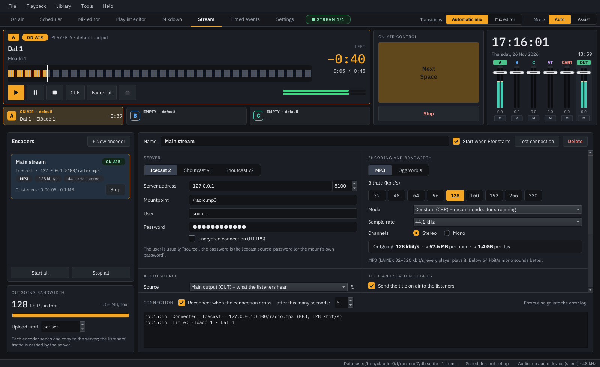
- **MIDI-vezérlés** (*Beállítások → MIDI*): MIDI-keverőpult (például RØDECaster Pro) vagy kontroller, tanuló móddal: a
  gombok indítják és leállítják a lejátszókat, a Következő, a kiúsztatás és a cartwall gombjai; a faderek hangerőt
  állítanak, vagy fader-indításként működnek.
- **Külső SQL szerver** (MySQL / MariaDB, *Beállítások → SQL szerver*): a szerver a fő tároló, helyi tartalékkal,
  így az adás sosem függ a hálózattól; a meglévő adatbázis átvihető (migrálás).
- **Saját elrendezés**: a nem használt lapok elrejthetők (*Beállítások → Lapok*); minden lista oszlopai
  átméretezhetők, a szélességeket a program megjegyzi. A felület mérete a *Beállítások → Megjelenés* lapon állítható.
- **Színsémák** (*Beállítások → Megjelenés*): öt beépített séma (Éter sötét, Grafit, Éjkék, Nagy kontraszt, Világos)
  és témaszerkesztő az alapszínekhez (háttér, panelek, gombok, keretek, szöveg, halvány szöveg, kiemelő szín,
  információ, rendben, hiba, a három lejátszó). A változás azonnal látszik; a saját sémák név szerint menthetők, és
  JSON-fájlba exportálhatók, illetve onnan importálhatók.
- **Pontos időre igazítás**: minden fix idejű elem (például az óra eleji hírek) előtt látszik, mennyi hiányzik vagy
  mennyivel lóg túl a playlist, és a program javítást javasol: beszúrandó számokat, vagy az ütemező által betett számok
  kivételét, illetve jobban illőre cseréjét, hogy a fix elem néhány másodpercen belül érkezzen (kis túllógás inkább
  kiúszik, mint hogy csend legyen). Automata módban ezt magától is elvégzi, legfeljebb 30 perccel előre.
- **Hiányzó fájlok**: a háttérben ellenőrzi a fájlokat; amelyik nem érhető el, az a sorban pirosan látszik jóval az
  adásba kerülése előtt. A teljes hangtár is átnézhető.
- **Adásrögzítés (logger)**: az adás óránkénti MP3 fájlokba kerül, a régieket a beállított idő után törli.
- **Adásnapló** CSV-exporttal.
- **Hibanapló:** minden hiba és figyelmeztetés (váratlan kilépés, összeomlás, felület, adatbázis, hang, stream, weboldal,
  SQL szerver, MIDI, …) napi szövegfájlokban a program mappájában (`logs/`); *Súgó → Hibanapló mappája…*.

| Színsémák és témaszerkesztő | Az automatikus mix előnézete |
|---|---|
| 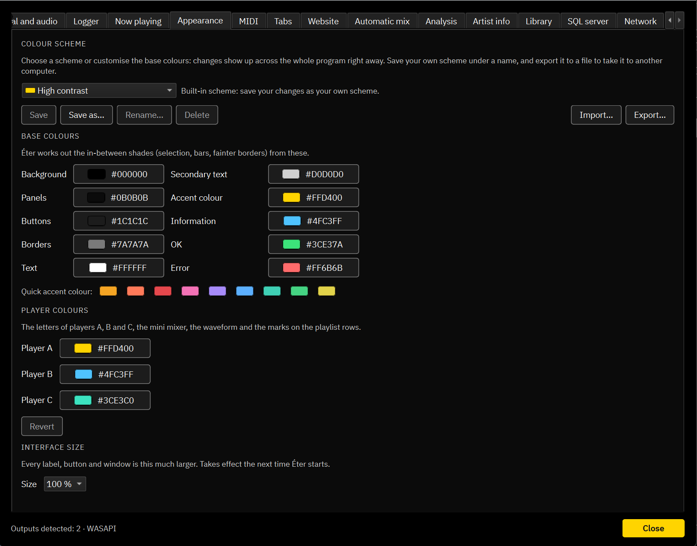 | 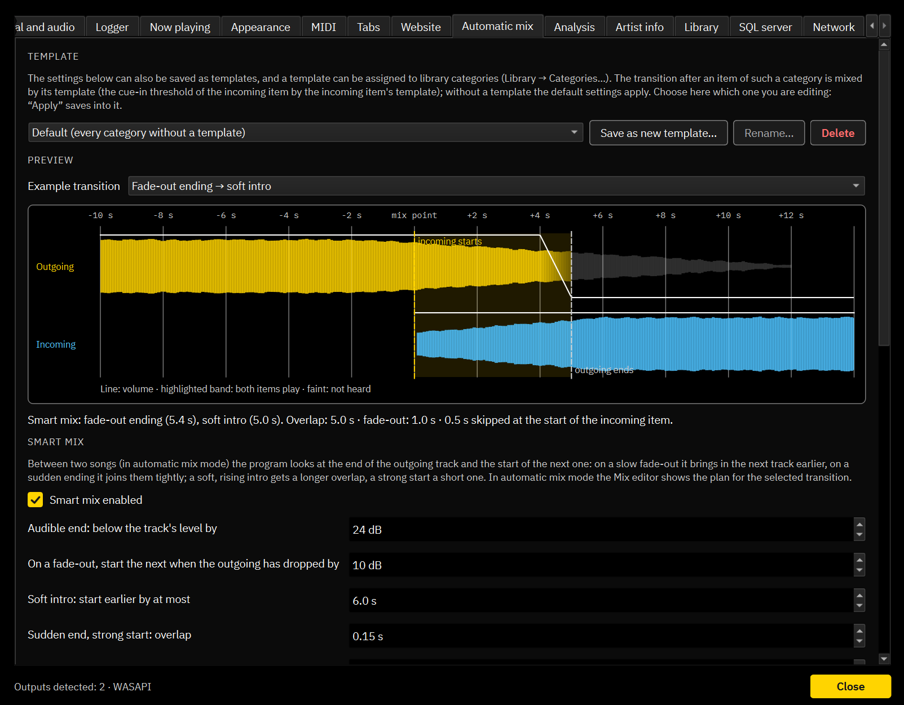 |

| MIDI-vezérlés tanuló móddal | Külső SQL szerver |
|---|---|
| 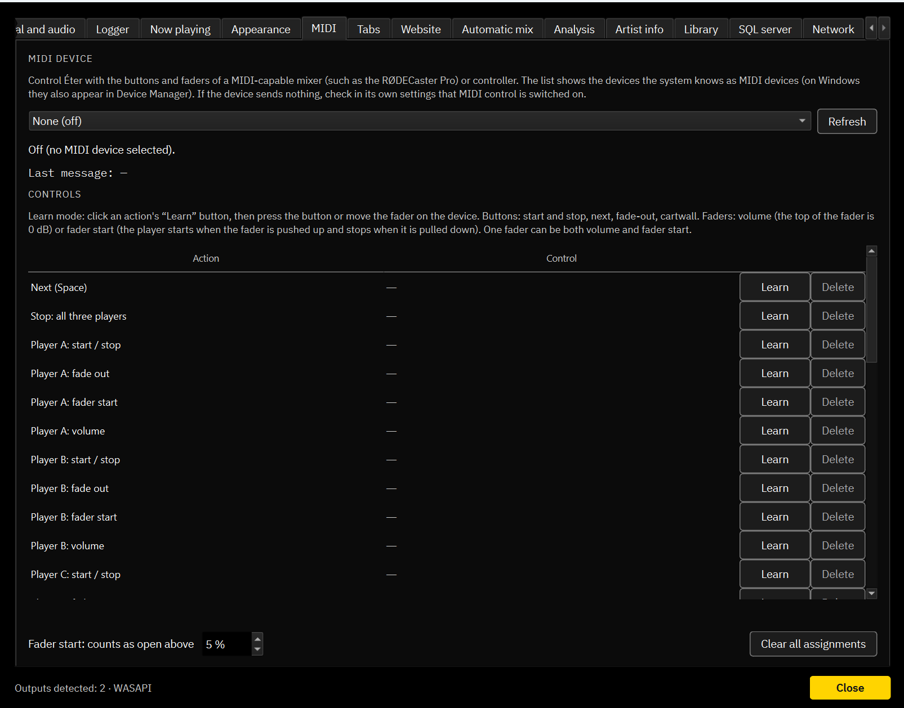 | 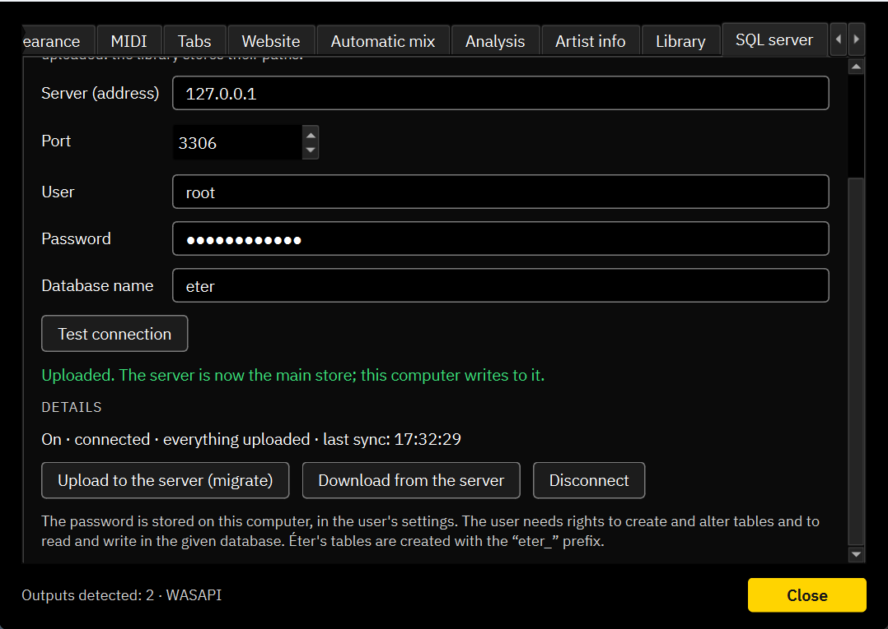 |

### Előkészítés

- **Hangtár** SQLite adatbázisban, saját kategóriákkal, fájlok és egész mappák importálásával,
  elemszerkesztővel (cím, előadó, album, év, kategória, kezdőpont, intro és outro jelölő).
- **Ütemező** (1920×1080-nál kisebb képernyőn külön ablakban nyílik): órasémák kategóriákból, fix idejű elemekkel, kitöltéssel, jegyzet sorokkal és soronkénti sweeperrel,
  több heti rács kézi vagy időszak szerinti váltással, előadó- (az „A and B” két előadó) és számismétlési szabályok, automatikus előre generálás. Az elemeknek energiája (1–5), tempója (a hangból
  becsülve vagy kopogtatva), hangneme és napszakai lehetnek; a szabályok szétválasztják a lassú számokat, korlátozzák
  az energiaugrást és a tempóváltást, és egy séma-hely energiasávot is kérhet. A kitöltés a következő fix pont közelében
  ér véget (az utolsó 1–3 számot együtt választja ki).
- **Hangnem és harmonikus keverés**: a hangtárban Hangnem oszlop van, Camelot (8A) vagy hagyományos (Am) jelöléssel
  (Beállítások → Elemzés). A hangnem a fájl címkéjéből (TKEY, INITIALKEY), az elemszerkesztőből (kézzel vagy
  *Becslés*), vagy a **háttérelemzésből** jön: ez a legkisebb prioritással végignézi a zenéket, és kitölti a hiányzó
  tempót és hangnemet – folyamatosan, vagy csak egy beállított időablakban (például éjjel); a kézzel vagy címkéből
  kapott értéket nem írja felül. Az ütemező **hangnem-szabálya** (Ütemező → Szabályok) a Camelot-kereket követi:
  *előnyben az illő* esetén illő hangnemű számot választ, ha amúgy is sorra kerülne egy; *csak illő* esetén kötelező, és
  csak akkor lazít, ha egyáltalán nincs illő jelölt. A playlistben minden szám tempója és hangneme látszik, a
  szabályt sértő átmenet figyelmeztető jelet kap, és a *Generálás* után az ütemező kiírja, hány átmenet tartja a tempó-
  és a hangnem-szabályt.
- **Mix editor** (1920×1080-nál kisebb képernyőn külön ablakban nyílik, így mellette látszik az adás): két vagy három egymást követő elem átmenete idővonalon állítható: mix pont, a kimenő elem
  vége, úsztatási görbék, kezdőpont, beúsztatás, intro, voice track (felvétel vagy fájl) és zenehalkítás,
  előhallgatással. Hármas nézetben a harmadik elemet a második eleje elé húzva és elengedve a középső elem
  ráfekszik az átmenetre, saját sávval. Bármelyik sávba kattintva onnan szól az előhallgatás. A nem zenei elemek
  alapból nem halkulnak el: a végükig szólnak a következő elem alatt.
- **Playlist szerkesztő**: kézzel összeállított playlistek mentése kategóriába, és beillesztésük
  a fő playlistbe kinyitható blokként.
- **Időzítések**: egy hangtárelem vagy mentett playlist beküldése a playlistbe (következőként vagy a
  végére), vagy azonnali indítása adásba; egyszer egy adott napon, vagy hetente a kiválasztott napokon.

### Távoli szerkesztés

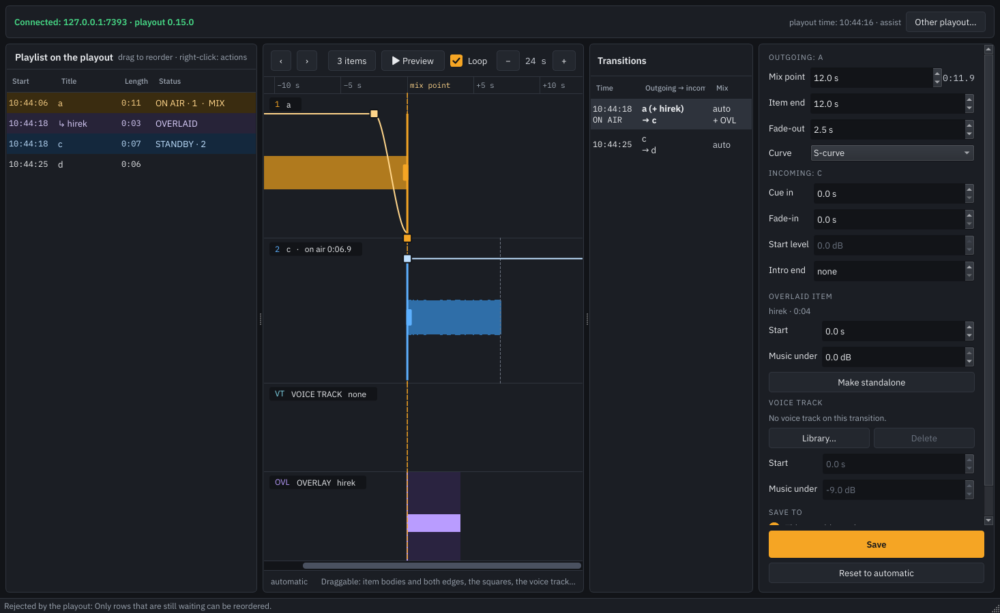

Egy playout gép már legenerált playlistje egy másik gépről szerkeszthető a hálózaton át: sorrend, törlés,
ráfektetés és a teljes Mix editor előhallgatással. Minden módosítást a playout hajt végre azonnal, a saját
adatbázisában és az adásban; minden csatlakozott szerkesztő az élő állapotot látja.

1. **A playout gépen**: Eszközök → Beállítások → Távoli szerkesztés. Pipáld be az *Engedélyezve*
   lehetőséget, adj meg portot (alapból 7341) és jelszót (legalább 6 karakter), majd *Alkalmazás*. Alatta
   látszanak a gép IP-címei. A tűzfalon engedélyezd a portot.
2. **A szerkesztő gépen**: Fájl → Távoli szerkesztő (vagy az Éter indítása `--editor` kapcsolóval; Windowson
   az `Eter-szerkeszto.cmd`). Add meg a playout IP-címét, a portot és a jelszót. A hangfájlokat a szerkesztő
   közös hálózati mappából olvassa: add meg a mappát úgy, ahogy a playout látja (például `D:\Zene`), és úgy,
   ahogy ez a gép (például `\\radio\Zene`, Linuxon `smb://radio/Zene`, ha a megosztást a fájlkezelőben már
   megnyitottad, vagy egy felcsatolt mappa, például `/mnt/zene`), vagy hagyd mindkettőt üresen, ha az útvonal azonos.

A szerkesztőben a playout hangtára is látszik: innen húzással vagy dupla kattintással kerülnek elemek a playlistbe.
A szerkesztő gépről hangfájlok tölthetők fel (gombbal, vagy a hangtárra, illetve a playlistre ejtve), és a szerkesztő
Mix editorában voice track is felvehető vagy fájlból betölthető; ezek a playoutra töltődnek fel.

Az alap jelszó mellett saját jelszavú és jogú felhasználók is felvehetők (sorrend, törlés, beszúrás, mix és ráfektetés,
feltöltés, tartalék playout) a Beállítások → Hálózat lapon; a nevükkel lépnek be.

A szerkesztő nem játszik adást, és a saját adatbázisához sem nyúl. A jelszó nem utazik a hálózaton
(kérdés–válasz HMAC-SHA256-tal), a playout pedig csak egy belőle képzett kulcsot tárol. Ha a kapcsolat
megszakad vagy a playout újraindul, a szerkesztő magától visszacsatlakozik.

### Tartalék playout

Egy második gép tartalékként állhat készenlétben: Fájl → Újraindítás tartalék playoutként (vagy az Éter indítása
`--backup` kapcsolóval; Windowson `Eter-tartalek.cmd`), majd add meg a fő playout címét, egy *tartalék playout* joggal
rendelkező felhasználót (vagy az alap jelszót), és ha kell, hogy hol van a közös hangfájlmappa a két gépen. A tartalék
másolatot tart a fő gép teljes adatbázisáról, és követi, mi szól. Ha a fő gép adás közben nem válaszol, a tartalék a
beállított idő (alapból 10 másodperc) után átveszi az adást, vagy beállítástól függően csak az *Átvétel most* gombra. A
szóló elemet onnan folytatja, ahol tartana. Ha a fő gép újra elérhető, a *Visszaadás a fő playoutnak* ugyanott adja
vissza neki az adást. A fő gép szabályos leállítása soha nem indít átvételt.

Mindkét gépnek el kell érnie a hangfájlokat (ugyanaz a közös mappa). Ha a két gép közti hálózat szakad meg, de mindkettő
fut, mindkettő adásba kerülhet: a tartalék a lefagyó vagy áramszünet miatt leálló fő gépre való.

### Egyéb

- Angol és magyar felület (Beállítások → Nyelv).
- **Adatbázis exportálása és importálása** (Beállítások → Adatbázis): a teljes adatbázis (hangtár, playlistek,
  ütemező, mixek, cartwall, beállítások – a hangfájlok nélkül) konzisztens másolata mentéshez vagy másik gépre
  költöztetéshez. Az import ellenőrzi a fájlt, előbb biztonsági mentést készít a mostaniról, majd az importálttal
  indítja újra az Étert.
- Egy adatbázissal egyszerre csak egy példány futhat: a második ugyanazt a playlistet játszaná egyszerre.

| Mix editor ráfektetett elemmel | Ütemező |
|---|---|
| 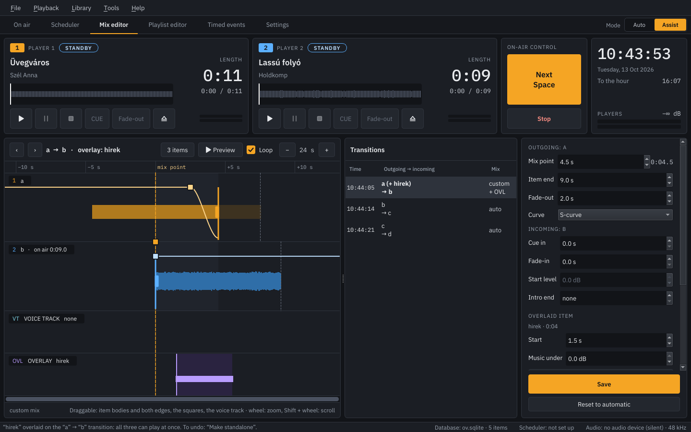 | 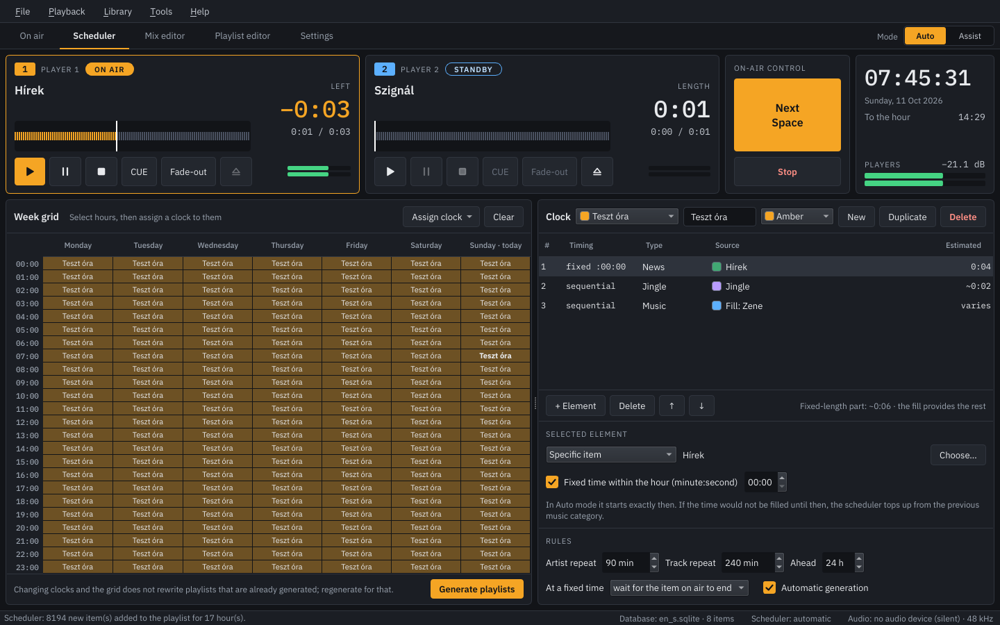 |

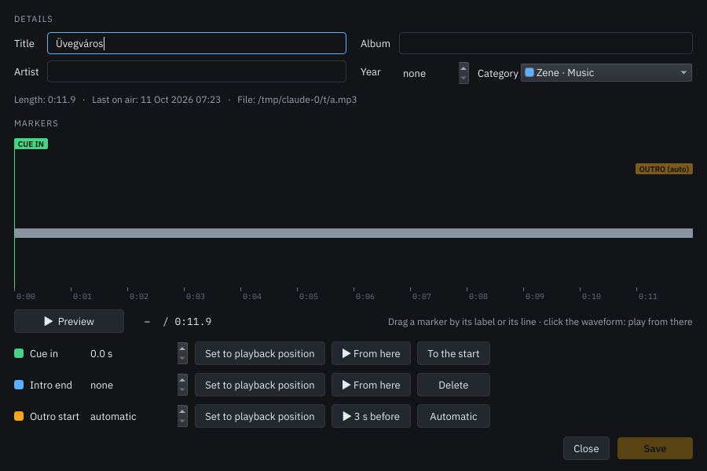

## Telepítés

### Linux

Töltsd le a legfrissebb `Eter-…-x86_64.AppImage` fájlt a Releases oldalról, majd:

    chmod +x Eter-*-x86_64.AppImage
    ./Eter-*-x86_64.AppImage

64 bites Linux kell hozzá glibc 2.39-cel vagy újabbal (Ubuntu 24.04 és későbbi, illetve hasonló
disztribúciók), a hanghoz PipeWire, PulseAudio, ALSA vagy JACK. A hangtár helye
`~/.local/share/eter/library.sqlite`, a beállításoké `~/.config/Eter/Eter.conf`.

### Windows

Töltsd le az `Eter-…-win64.zip` fájlt a Releases oldalról, csomagold ki bárhová, és indítsd el az
`eter.exe`-t (64 bites Windows 10 vagy 11); az `Eter-szerkeszto.cmd` a távoli szerkesztőt, az `Eter-tartalek.cmd` a tartalék playoutot indítja. A program
nincs digitálisan aláírva, ezért az első indításkor a Windows „ismeretlen kiadó” figyelmeztetést adhat. A hang
WASAPI-n megy. A hangtár helye `%LOCALAPPDATA%\eter\library.sqlite`, a beállítások a rendszerleíró
adatbázisban vannak (`HKEY_CURRENT_USER\Software\Eter`).

A windowsos változat jóval kevesebb tesztelést kapott, mint a linuxos.

### Mindkettő

A hangfájlokat a program nem másolja és nem módosítja, a hangtár csak hivatkozik rájuk. A korábbi verziók
adatbázisát az első indításkor automatikusan frissíti. Az adatbázis mentéséhez vagy másik gépre költöztetéséhez
a Beállítások → Adatbázis (exportálás, importálás) való.

A Beállítások → Általános és hang lapon mindegyik lejátszóhoz (A, B, C), az előhallgatáshoz és a cartwallhoz külön
hangkártya választható; a Beállítások → Most szól lapon a címfájl és az Icecast-frissítés állítható be.

Hasznos kapcsolók: `--editor` (távoli szerkesztő), `--backup` (tartalék playout), `--backend NÉV` (Linuxon `pulseaudio`, `alsa`, `jack`;
Windowson `wasapi`, `dsound`), `--db FÁJL` (másik adatbázis), `--selftest FÁJL` (a hangmotor ellenőrzése egy
hangfájllal), `--help`.

## Fordítás forrásból

### Linux

Ubuntu 24.04-en vagy újabbon:

    sudo apt install build-essential cmake ninja-build nasm git curl \
        qt6-base-dev libqt6sql6-sqlite qt6-wayland libgl1-mesa-dev libmp3lame-dev libvorbis-dev
    scripts/build_ffmpeg.sh      # kis, statikus FFmpeg csak hangdekóderekkel, a third_party/ffmpeg alá
    cmake -S . -B build/release -G Ninja
    cmake --build build/release
    build/release/eter

AppImage készítése (első alkalommal letölti a linuxdeploy eszközt):

    scripts/build_appimage.sh    # eredmény: build/Eter-<verzió>-x86_64.AppImage

### Windows

[MSYS2](https://www.msys2.org/) **UCRT64** parancssorban:

    pacman -S --needed git make diffutils zip mingw-w64-ucrt-x86_64-gcc mingw-w64-ucrt-x86_64-cmake \
        mingw-w64-ucrt-x86_64-ninja mingw-w64-ucrt-x86_64-nasm mingw-w64-ucrt-x86_64-qt6-base \
        mingw-w64-ucrt-x86_64-lame mingw-w64-ucrt-x86_64-libvorbis
    scripts/build_ffmpeg.sh
    scripts/build_windows.sh     # eredmény: build/Eter-<verzió>-win64.zip

VS Code-ból: telepítsd az MSYS2-t az alapértelmezett helyére (`C:\msys64`), nyisd meg a projekt
mappáját, majd Terminal → Run Task…, és futtasd sorban az „Éter: 1 … 4” nevű feladatokat (az első
kettőt csak egyszer kell). Utána a Ctrl+Shift+B újraépíti a csomagot. A projekt olyan útvonalon
legyen, amelyben nincs szóköz és ékezetes betű, például `C:\eter`.

### Kiadások

Ha egy `v0.29.3` formájú címkét (tag) töltesz fel, a `.github/workflows/build.yml` munkafolyamat
megépíti az AppImage-et és a windowsos zipet, és egy kiadáshoz (release) csatolja őket.

### Weboldal

A program weboldala ([laczfy001.github.io/eter](https://laczfy001.github.io/eter/), angolul) a `site/` mappából
készül: minden `main` ágra feltöltés után a `.github/workflows/pages.yml` munkafolyamat építi és teszi közzé. Benne
a funkciók összefoglalója, a `docs/screenshots` képei, és a `CHANGELOG.md` legújabb része („What's new”). A letöltő
gombok a böngészőben kérdezik le a legutóbbi kiadás fájljait, így új kiadásnál az oldalon nem kell változtatni.
Egyszeri beállítás a GitHubon: *Settings → Pages → Build and deployment → Source: GitHub Actions*. Helyi előnézet:
`python3 scripts/build_site.py`, utána a `build/site/index.html` megnyitása.

## A forrás felépítése

- `src/audio` – dekóder (FFmpeg → 48 kHz sztereó), források (dekódoló szál és gyűrűpuffer),
  hangmotor (miniaudio: kimenetek, útválasztás, keverés, felvétel)
- `src/ui` – főablak, lejátszók, hangtár, ütemező, mix editor és mini mix editor, playlist szerkesztő,
  cartwall, időzítések, távoli szerkesztő
- `src/net` – a távoli szerkesztés protokollja (soronkénti JSON TCP-n, HMAC-belépés), szerver és kliens; a weboldal-szinkron
- `wordpress/eter-radio` – a WordPress-bővítmény (csomagolás: `scripts/build_wp_plugin.sh`)
- `web/eter-web` – az univerzális webes modul (csomagolás: `scripts/build_web_module.sh`)
- `src/core` – hiányzó fájlok ellenőrzése, „most szól” kiírás (címfájl, Icecast-frissítés)
- `src/db` – SQLite réteg és adatbázis-frissítések; `schema.sql` – az adatbázis sémája
- `src/sched` – playlist-generálás
- `packaging` – asztali bejegyzés, windowsos erőforrások, az AppImage-ben használt libproxy-helyettesítő
- `i18n/en.json` – a felület angol szövegei

A forrás megjegyzései magyarul vannak. Az egyes verziók változásai: [CHANGELOG.md](CHANGELOG.md); a 0.18 óta érkezett újdonságok angol nyelvű
összefoglalója: [docs/whats-new-since-0.18.md](docs/whats-new-since-0.18.md).

## Fordítások

A felület szövegei a forrásban magyarul vannak, `TR("magyar szöveg")` alakban; az angol
megfelelőjük az `i18n/en.json` fájlban van. Módosítás után `python3 scripts/gen_i18n.py`
generálja újra a táblát.

## Készítők

Tervezte és irányította: laczfy001. A kódot Claude, az Anthropic MI-asszisztense írta.

## Licenc

Az Éter szabad szoftver, a [GNU General Public License 3.0 vagy újabb](LICENSE) feltételei
szerint. A felhasznált könyvtárak és licenceik: [THIRD-PARTY-NOTICES.md](THIRD-PARTY-NOTICES.md).
