# Éter

Radio playout and automation for Linux and Windows: three players (A, B, C) with automatic or hand-made mixing,
a cartwall, a music library, a scheduler, a mix editor, remote playlist editing, a program logger, now playing output
for Icecast and a backup playout in one desktop application.

**Website and downloads: [laczfy001.github.io/eter](https://laczfy001.github.io/eter/)** · *Magyar leírás: [README.hu.md](README.hu.md)*

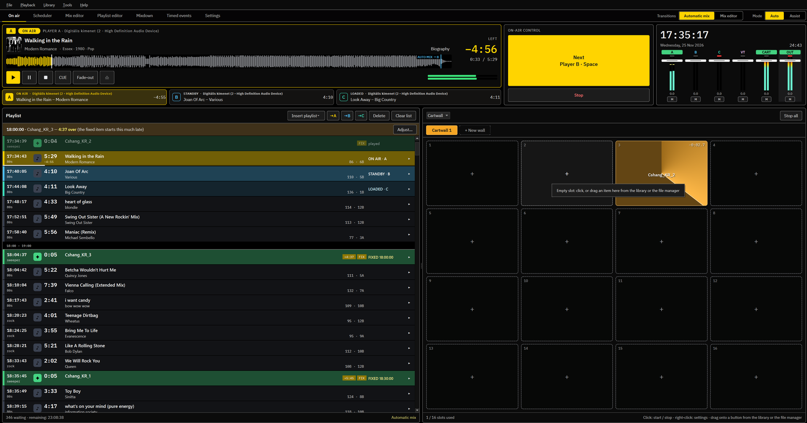

## Features

### On air

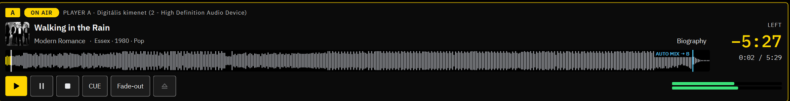

- **Three players (A, B, C)**, of which the main window shows one: the one on air. A strip under it shows all three
  (ON AIR / FADING / STANDBY, title, time, output) and, while one plays, the voice track; click a player in the strip
  to look at it. With three players a song, a jingle and the next song can all sound at once (the next song starting
  under the jingle while the previous one is still fading), in automatic and in assisted mode alike.
  Waveform, intro countdown, mix point on the waveform, automatic or assisted crossfading. In the last
  10 seconds of the item on air a red countdown appears at the bottom of the window (in automatic mode it counts
  to the mix point); it never takes clicks.
  Every channel (players A, B and C, preview, cartwall) can go to its own sound card.
- **Mixdown**: build a sequence of items with voice tracks on its own timeline (transitions set by the smart mix,
  then freely adjustable; voice tracks are recorded where you click on the timeline) and render it to one MP3 or WAV file, which also goes into the library's "Mixdown"
  category.
- **Mini mixer** in the clock panel: level meters and faders for the three players, the voice track, the cartwall and
  the main output, with mute.
- **Vocal rule**: tag tracks as male, female, group, mixed or instrumental (one by one or many at once from the
  library), and limit how many of the same vocal play in a row.
- **Smart automatic mix**: recognises fade-out and sudden endings, soft and strong intros, and (optionally) shortens the
  overlap when tempos or keys clash; every threshold is adjustable in *Settings → Automatic mix* (with a live
  diagram of how two example items are mixed), and the Mix editor shows the plan for each transition. Jingles, ads,
  news and voice tracks follow each other back to back with the silence cut at both ends; a hidden track after a long silence is left out; a dead-air guard moves on when the item
  on air stays silent.
- **Live streams**: an Icecast/Shoutcast stream (MP3, AAC, Ogg; http or https; .pls/.m3u resolved) can be a
  playlist item with a planned length; it reconnects when it drops and moves on if it stays down.
- **Automatic mix / Mix editor** switch in the top bar: with *Automatic mix* the transitions between two songs are
  mixed by the program from the waveform (silence at the start of the next song is skipped); transitions where
  either side is not music (jingles, news, ads) still follow their saved Mix editor settings, and saved voice
  tracks still play. With *Mix editor* every transition follows its saved settings.
- **Volume curve** for each item, drawn on the waveform in the Mix editor or the item editor: for example a news jingle
  stays at full level at the start and its bed continues quieter under the newsreader. It applies wherever the item plays.
- **Now playing**: the title of the item on air is written to a text file at every change, from a template
  (`%artist% - %title%`, also `%category%`, `%duration%`, `%next_artist%`, `%next_title%`, `%time%`), for a stream
  encoder (butt, Liquidsoap, Mixxx, OBS…), a website or an on-screen caption. For jingles and other non-music items
  the previous song's title can stay, or their own title or a fixed text can be shown. Optionally Éter updates the
  Icecast server's metadata directly (admin/metadata). Settings → Now playing.
- **Website (WordPress)**: with the Éter Radio plugin (`eter-radio.zip`, attached to each release) the site gets
  *Now playing*, *Up next* and *Song request* blocks (and the shortcodes `[eter_now_playing]`, `[eter_up_next]`,
  `[eter_request]`). Éter sends what is on air every few seconds and collects the requests; it always opens the
  connection itself (signed HTTPS), so the studio computer does not have to be reachable from the internet.
  A requested track goes into the playlist right after the item on air, below any earlier requests, marked REQUEST;
  without requests the playlist runs as usual. Requests can go in automatically or wait for approval (Requests
  button in the top bar), can be limited to selected categories and to the hours of selected clocks.
  Settings → Website; in WordPress: Settings → Éter Radio (also the plugin's language: English by default, Dutch,
  Hungarian, or the site's language). A *Most played* block shows the top songs of the last day, week or month.
- **Éter Web** (`eter-web.zip`): the same widgets for any website without WordPress – one folder on any PHP web host,
  embedded with a script line (or an iframe). See `web/eter-web/README.txt`.
- **Playlist** with planned air times and hour separators. Each row shows the start time, a type icon,
  the length, title and artist, and marks for custom mixes (MIX), voice tracks (VT) and fixed times (FIX).
  Non-music items are filled with their category colour; the item on air and the one on standby stand out,
  with a progress bar on the item on air.
- **The playlist follows the item on air** unless you scroll away; scrolling back turns following on again.
- **Mini mix editor in the playlist**: the arrow at the end of a row opens the transition to the next item.
  Drag the next item onto the end of the outgoing one, listen to the transition, reset it, or open it in the
  full Mix editor.
- **Overlay**: an item can be laid over the transition between the items before and after it, so all three
  play at once (for example a jingle over a crossfade). It plays on its own channel; right-click a waiting
  item → "Overlay on the transition", or drag in the Mix editor (see below).
- **Cartwall** in place of the library (the view selector above the library): coloured walls of instant-start buttons, filled from the library or
  from files, with its own output (by default it follows player A).
- **Artist info** from MusicBrainz (free), Wikipedia and TheAudioDB (*Settings → Artist info*, each optional): photo,
  country, years, genre and biography in the player; empty album and year filled in. The separate **Info window**
  (library header *Info* button, *Tools → Info window*, Ctrl+I) shows everything known about the selected or the
  on-air item.
- **Stream encoders** (*Stream* tab, *Tools → Stream encoder…*): Éter streams to Icecast 2 or Shoutcast (v1, v2)
  servers itself, in MP3 (32–320 kbit/s, CBR or ABR) or Ogg Vorbis (48–320 kbit/s), with sample rate and mono/stereo
  per encoder. Several encoders can run at once (for example a 128 kbit/s MP3 and a 64 kbit/s mobile stream), each from
  the main output or from a sound card input (a mixing desk). The title on air goes to the listeners, a peak limiter
  keeps the stream clean, dropped connections are retried, and the total outgoing bandwidth is shown against your
  upload limit. A STREAM badge in the tab row shows the state on every tab.

  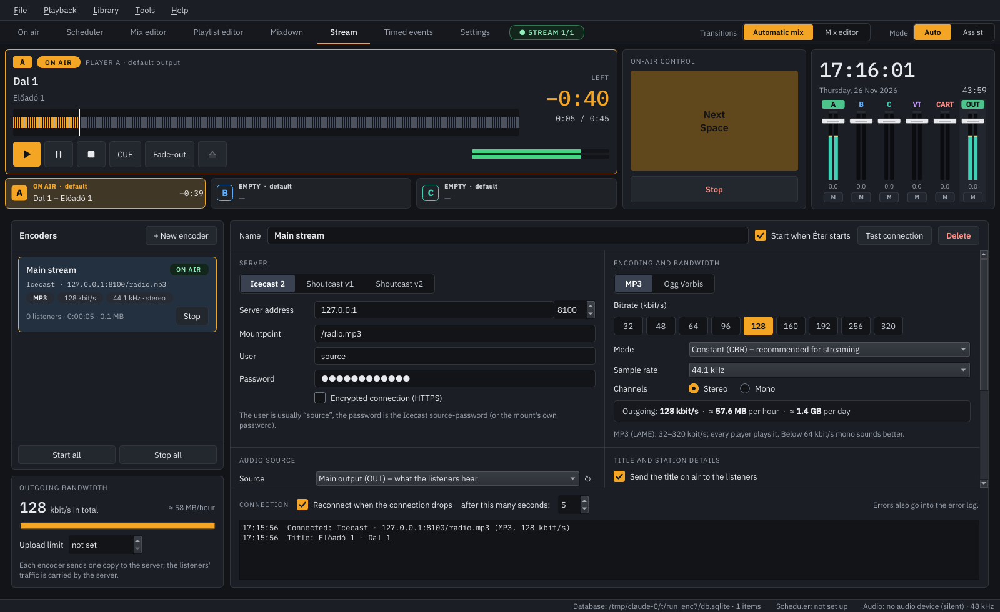
- **MIDI control** (*Settings → MIDI*): a MIDI mixer such as the RØDECaster Pro, or any controller, with learn mode:
  buttons start and stop players, *Next*, fade-out and cartwall; faders set volumes or work as fader start.
- **External SQL server** (MySQL / MariaDB, *Settings → SQL server*): the server is the main store, with a local
  copy as a reserve so the broadcast never depends on the network; migration of the existing database included.
- **Your layout**: hide the tabs you do not use (*Settings → Tabs*); every list's columns can be resized, and the
  widths are remembered. Interface size is set under *Settings → Appearance*.
- **Colour schemes** (*Settings → Appearance*): five built-in schemes (Éter dark, Graphite, Midnight blue, High
  contrast, Light) and a theme editor for the base colours (background, panels, buttons, borders, text, secondary
  text, accent, information, OK, error, the three players). Changes show at once; your own schemes are saved by name
  and can be exported to and imported from a JSON file.
- **On time**: before every fixed-time item (the news at the top of the hour, say) the playlist shows how much is
  missing or over, and suggests a fix: tracks to add, or scheduler-placed tracks to drop or swap for better fitting ones,
  so the fixed item arrives within a few seconds (a small overrun is faded out rather than leaving silence). In
  automatic mode it can do this by itself, up to 30 minutes ahead.
- **Missing files** are found in the background: rows whose file cannot be reached turn red well before they would go on
  air, and the whole library can be checked as well.
- **Program logger**: what goes on air is recorded into hourly MP3 files, old ones are deleted after a set time.
- **Play log** with CSV export.
- **Error log:** every error and warning (unexpected exit, crash, interface, database, audio, stream, website, SQL
  server, MIDI, …) in daily text files in the program folder (`logs/`); *Help → Error log folder…*.

| Colour schemes and the theme editor | Preview of the automatic mix |
|---|---|
| 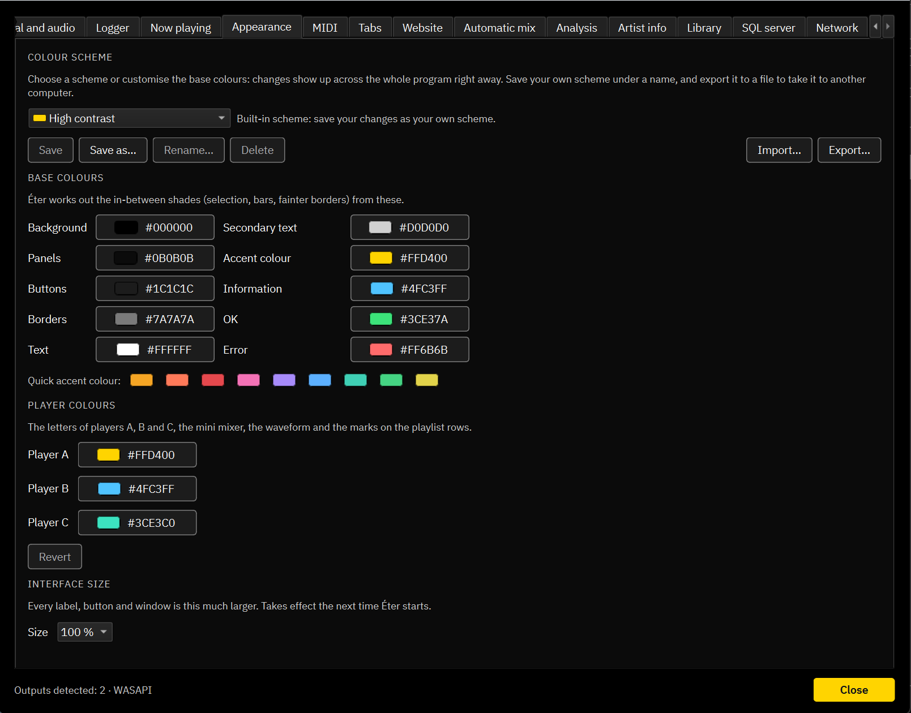 | 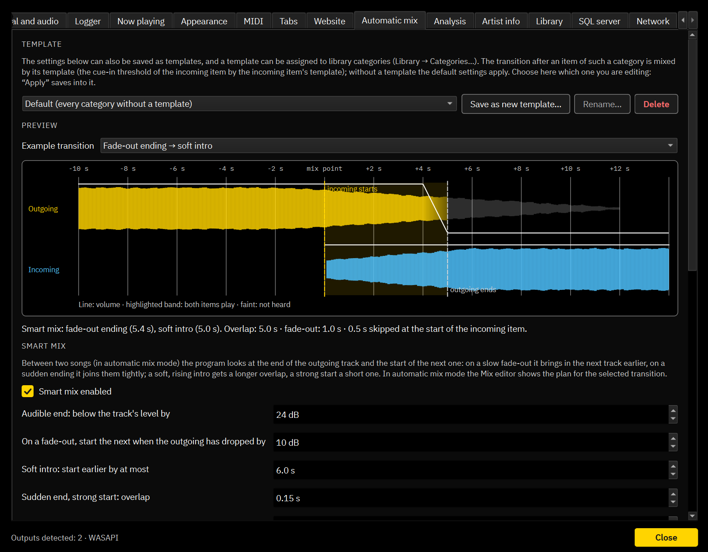 |

| MIDI control with learn mode | External SQL server |
|---|---|
| 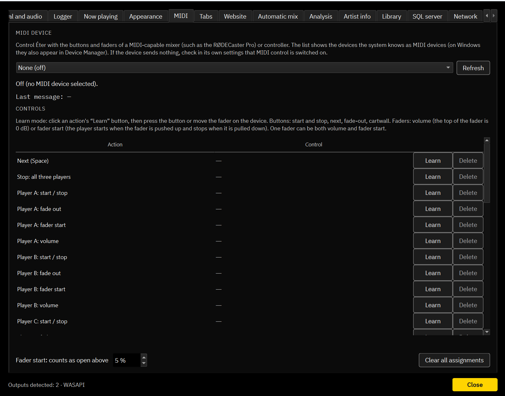 | 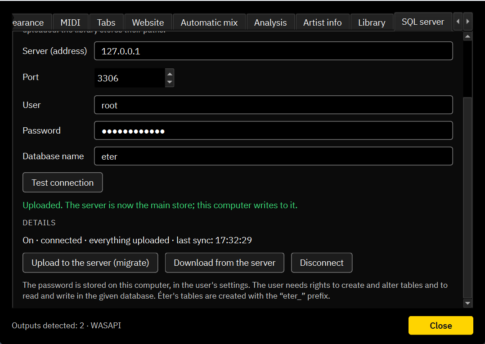 |

| Colour schemes and the theme editor | Preview of the automatic mix |
|---|---|
|  |  |

| MIDI control with learn mode | External SQL server |
|---|---|
|  |  |

### Preparation

- **Library** in SQLite with user-defined categories, import of files and whole folders, and an item editor
  for title, artist, album, year, category, cue-in, intro and outro markers.
- **Scheduler** (on screens below 1920×1080 it opens in its own window): clocks built from categories, fixed-time elements and fills, note rows and per-row sweepers,
  several week grids switched by hand or by date period, artist (“A and B” counts as two) and title separation, automatic generation ahead of time. Items can have an energy (1–5), a tempo (estimated
  from the audio or tapped in), a musical key and dayparts; rules keep slow songs apart, limit energy jumps and tempo
  changes, and a clock slot can ask for an energy band. Fills end close to the next fixed point (the last 1–3 tracks
  are chosen together).
- **Musical key and harmonic mixing**: the library has a Key column, shown in Camelot (8A) or traditional (Am)
  notation (Settings → Analysis). Keys come from the file's tags (TKEY, INITIALKEY), the item editor (manual or
  *Estimate*), or the **background analysis**, which goes through the music at the lowest priority and fills in missing
  tempos and keys – continuously, or only in a time window you set (for example at night); it never overwrites values
  entered by hand or taken from tags. The scheduler's **key rule** (Scheduler → Rules) follows the Camelot wheel: *prefer
  matching* picks a track in a matching key when one is due anyway, *matching only* requires it and relaxes only when
  there is no matching candidate at all. The playlist shows each track's tempo and key and marks transitions that
  break a rule, and *Generate playlists* reports how many transitions keep the tempo and key rules.
- **Mix editor** (on screens below 1920×1080 it opens in its own window, so the on-air view stays visible): set the transition between two or three consecutive items on a timeline: mix point,
  end of the outgoing item, fade curves, cue-in, fade-in, intro, voice tracks (recorded or from file) and
  music ducking, with preview. In the three-item view, drag the third item in front of the second one and
  release: the middle item is overlaid on the transition, with its own lane. Click anywhere in a lane to listen from
  that point. Items that are not music are not faded out by default: they play to their end under the next item.
- **Playlist editor**: build playlists by hand, save them into categories and insert them into
  the main playlist as collapsible blocks.
- **Timed events**: send a library item or a saved playlist into the playlist (as next or at the end),
  or start it on air, once on a date or weekly on chosen days.

### Remote editing

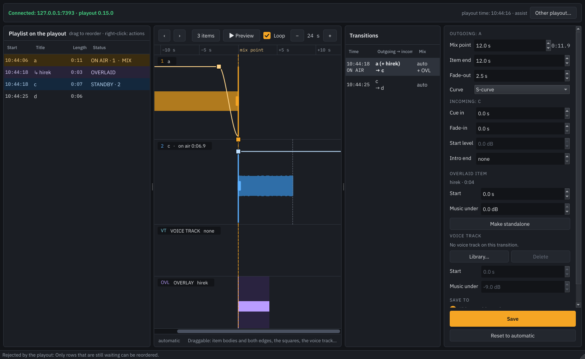

The already generated playlist of a playout computer can be edited from another computer on the network:
order, delete, overlay, and the full Mix editor with preview. Every change is carried out by the playout at
once, in its own database and on air; every connected editor sees the live state.

1. **On the playout computer**: Tools → Settings → Remote editing. Tick *Enabled*, choose a port
   (default 7341) and a password (at least 6 characters), then *Apply*. The computer's IP addresses are shown
   below. Allow the port in the firewall.
2. **On the editing computer**: File → Remote editor (or start Éter with `--editor`; on Windows run
   `Eter-szerkeszto.cmd`). Enter the playout's IP address, the port and the password. The audio files are read
   from a shared network folder: give the folder as the playout sees it (for example `D:\Music`) and as this
   computer sees it (for example `\\radio\Music`, or on Linux `smb://radio/Music` once the share has been opened in the
   file manager, or a mounted folder such as `/mnt/music`), or leave both empty if the paths are the same.

The playout's library is shown in the editor too: drag or double-click items into the playlist. Audio files can be
uploaded from the editing computer (button, or drop them onto the library or the playlist), and voice tracks can be
recorded or loaded from file in the editor's Mix editor; they are uploaded to the playout.

Besides the main password, users with their own password and rights (order, delete, insert, mix and overlay, upload,
backup playout) can be added under Settings → Network; they log in with their name.

The editor does not play anything on air and does not touch its own database. The password never travels
over the network (challenge–response with HMAC-SHA256), and the playout stores only a key derived from it.
The editor reconnects by itself if the connection drops or the playout restarts.

### Backup playout

A second computer can stand by as a backup: File → Restart as backup playout (or start Éter with `--backup`; on Windows
`Eter-tartalek.cmd`), then enter the main playout's address, a user with the *backup playout* right (or the main
password) and, if needed, where the shared audio folder is on both computers. The backup keeps a copy of the main
computer's whole database and follows what is on air. If the main computer stops answering while something is playing,
the backup takes over after the set time (default 10 seconds), or only when *Take over now* is pressed, as set. It
continues the item that was playing. When the main computer is back, *Hand back to the main playout* returns the
programme there at the same point. A normal shutdown of the main computer never triggers a takeover.

Both computers need to reach the audio files (the same shared folder). If the network between them fails but both
keep running, both could be on air: the backup is meant for a main computer that crashes or loses power.

### Other

- English and Hungarian interface (Settings → Language).
- **Database export and import** (Settings → Database): a consistent copy of the whole database (library, playlists,
  scheduler, mixes, cartwall, settings – not the audio files) for backups or moving to another computer. Import checks
  the file, backs up the current database first and restarts Éter with the imported one.
- Only one copy can run with the same database: a second copy would play the same playlist at the same time.

| Mix editor with an overlaid item | Scheduler |
|---|---|
| 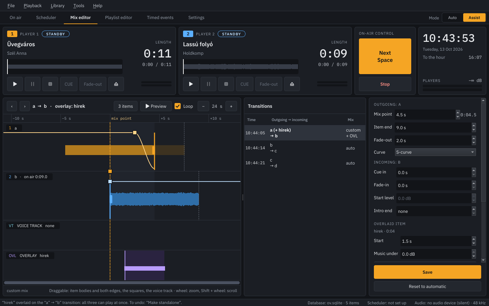 | 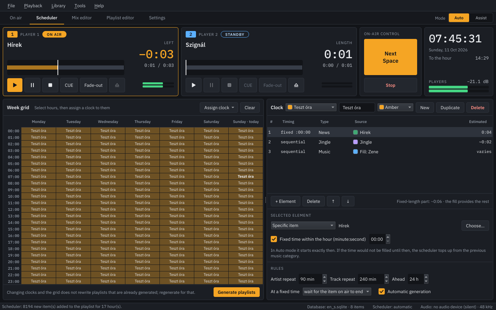 |

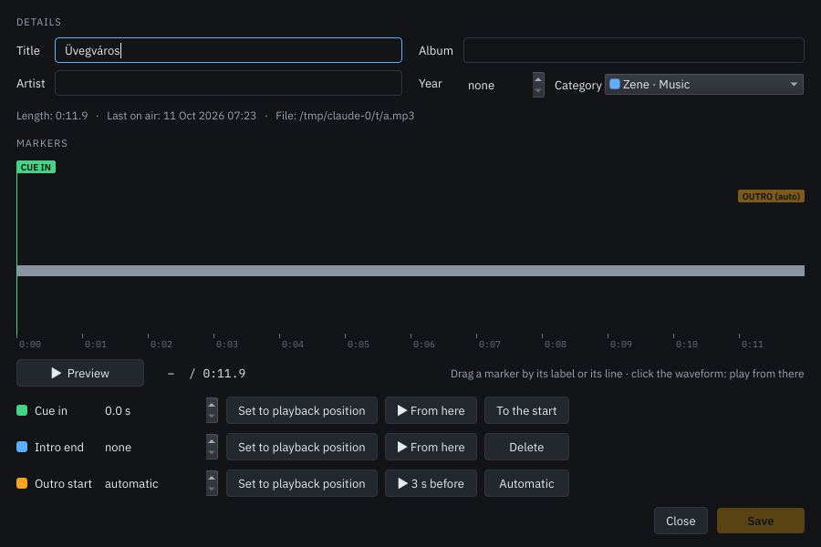

## Install

### Linux

Download the latest `Eter-…-x86_64.AppImage` from the Releases page, then:

    chmod +x Eter-*-x86_64.AppImage
    ./Eter-*-x86_64.AppImage

It needs a 64-bit Linux with glibc 2.39 or newer (Ubuntu 24.04 and later, and comparable
distributions) and PipeWire, PulseAudio, ALSA or JACK for sound. The library is stored in
`~/.local/share/eter/library.sqlite`, the settings in `~/.config/Eter/Eter.conf`.

### Windows

Download `Eter-…-win64.zip` from the Releases page, unpack it anywhere and start `eter.exe`
(64-bit Windows 10 or 11); `Eter-szerkeszto.cmd` starts the remote editor, `Eter-tartalek.cmd` the backup playout. The program is not code-signed,
so Windows may show an “unknown publisher” warning on first start. Sound goes through WASAPI. The library is
stored in `%LOCALAPPDATA%\eter\library.sqlite`, the settings in the registry under
`HKEY_CURRENT_USER\Software\Eter`.

The Windows build has been tested far less than the Linux one.

### Both

Audio files are never copied or modified; the library only refers to them. Databases from older versions
are upgraded automatically on first start. To back up the database or move it to another computer, use
Settings → Database (export, import).

Settings → General and audio chooses a sound card for each player (A, B, C), the preview and the cartwall; Settings → Now playing
sets up the title file and the Icecast update.

Useful options: `--editor` (remote editor), `--backup` (backup playout), `--backend NAME` (`pulseaudio`, `alsa`, `jack` on Linux;
`wasapi`, `dsound` on Windows), `--db FILE` (use another database), `--selftest FILE` (check the audio
engine with an audio file), `--help`.

## Build from source

### Linux

On Ubuntu 24.04 or newer:

    sudo apt install build-essential cmake ninja-build nasm git curl \
        qt6-base-dev libqt6sql6-sqlite qt6-wayland libgl1-mesa-dev libmp3lame-dev libvorbis-dev
    scripts/build_ffmpeg.sh      # small static FFmpeg with audio decoders only, into third_party/ffmpeg
    cmake -S . -B build/release -G Ninja
    cmake --build build/release
    build/release/eter

To package the AppImage (downloads linuxdeploy on first use):

    scripts/build_appimage.sh    # result: build/Eter-<version>-x86_64.AppImage

### Windows

In an [MSYS2](https://www.msys2.org/) **UCRT64** shell:

    pacman -S --needed git make diffutils zip mingw-w64-ucrt-x86_64-gcc mingw-w64-ucrt-x86_64-cmake \
        mingw-w64-ucrt-x86_64-ninja mingw-w64-ucrt-x86_64-nasm mingw-w64-ucrt-x86_64-qt6-base \
        mingw-w64-ucrt-x86_64-lame mingw-w64-ucrt-x86_64-libvorbis
    scripts/build_ffmpeg.sh
    scripts/build_windows.sh     # result: build/Eter-<version>-win64.zip

From VS Code: install MSYS2 to its default place (`C:\msys64`), open the project folder, then
Terminal → Run Task… and run the tasks named “Éter: 1 … 4” in order (the first two only once).
Afterwards Ctrl+Shift+B rebuilds the package. Keep the project in a path without spaces or
accented letters, for example `C:\eter`.

### Releases

Pushing a tag such as `v0.29.3` makes the GitHub workflow in `.github/workflows/build.yml`
build the AppImage and the Windows zip and attach them to a release.

### Website

The project website ([laczfy001.github.io/eter](https://laczfy001.github.io/eter/)) is built from `site/` by
`.github/workflows/pages.yml` after every push to `main`: an English summary of the features, the screenshots from
`docs/screenshots`, and the newest section of `CHANGELOG.md` as "What's new". The download buttons look up the files
of the latest release in the browser, so a new release needs no change to the site. One-time setup on GitHub:
*Settings → Pages → Build and deployment → Source: GitHub Actions*. Local preview:
`python3 scripts/build_site.py`, then open `build/site/index.html`.

## Source layout

- `src/audio` – decoder (FFmpeg → 48 kHz stereo), sources (decode thread and ring buffer),
  engine (miniaudio: outputs, routing, mixing, recording)
- `src/ui` – main window, players, library, scheduler, mix editor and mini mix editor, playlist editor,
  cartwall, timed events, remote editor
- `src/net` – remote editing protocol (JSON lines over TCP, HMAC login), server and client; website sync
- `wordpress/eter-radio` – the WordPress plugin (pack it with `scripts/build_wp_plugin.sh`)
- `web/eter-web` – the universal web module (pack it with `scripts/build_web_module.sh`)
- `src/core` – missing file check, now playing output (title file, Icecast update)
- `src/db` – SQLite layer and migrations; `schema.sql` – the database schema
- `src/sched` – playlist generation
- `packaging` – desktop entry, Windows resources, the libproxy stand-in used in the AppImage
- `i18n/en.json` – English interface text (see [CONTRIBUTING.md](CONTRIBUTING.md))

Source comments are in Hungarian. The changes of each version are listed in [CHANGELOG.md](CHANGELOG.md); a summary of what is new since 0.18 is in
[docs/whats-new-since-0.18.md](docs/whats-new-since-0.18.md).

## Credits

Designed and directed by laczfy001. The code was written with Claude, Anthropic's AI assistant.

## Licence

Éter is free software under the [GNU General Public License v3.0 or later](LICENSE).
Third-party components and their licences are listed in
[THIRD-PARTY-NOTICES.md](THIRD-PARTY-NOTICES.md).
